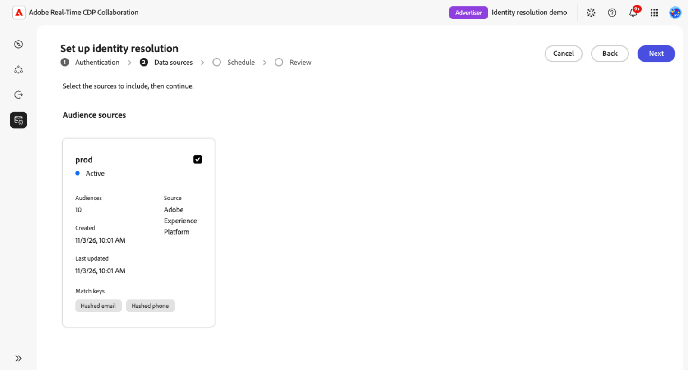

# ID解決の設定と管理

{{limited-availability-release-note}}

IDの解決は、組織が様々なIDを使用している場合でも、共同作業者と共通する顧客を特定するのに役立ちます。 各パートナーのカスタム統合を構築することなく、Real-Time CDP Collaborationのサポート対象ID プロバイダーを使用して、ID解決を設定、管理できます。

>[!NOTE]
>
>このガイドの手順とスクリーンショットでは、[!DNL Epsilon Core ID]を例として使用しています。 要件と利用可能なオプションは、ID プロバイダーによって異なります。

>[!AVAILABILITY]
>
>起動時に、設定に使用できるのは[!DNL Epsilon Core ID]のみです。 Epsilon Core ID解決は、米国でプロビジョニングされたReal-Time CDP Collaboration アカウントでのみ使用できます。

## 前提条件 {#prerequisites}

始める前に、次の項目を確認してください。

* **アカウント管理権限。** **[!UICONTROL Manage Account]**&#x200B;および&#x200B;**[!UICONTROL Manage Collaboration Instances]**&#x200B;権限が必要です。
* **少なくとも1つのオーディエンスデータ接続。** ID解決を設定するには、既存のオーディエンスデータ接続が必要です。 [必要に応じてオーディエンスソーシング ](./source-overview.md)を設定します。 測定データの接続はサポートされていません。
* **一致するキーとフィールドをサポートしています。** ID解決に使用する各オーディエンスデータ接続には、ID プロバイダーでサポートされているフィールドが含まれている必要があります。 Epsilon Core IDの場合、ハッシュ化された電子メール、ハッシュ化された電話、または名前を郵送先住所と組み合わせて使用できます。

  ハッシュ化された電子メールやハッシュ化された電話などのアカウントレベルの照合キーは、アカウントに対して有効にし、オーディエンスデータにマッピングする必要があります。 名前フィールドと住所フィールドは、オーディエンスデータ接続の設定中にマッピングされ、アカウントレベルの有効化は必要ありません。

  名前と住所を使用する場合は、各グループから少なくとも1つのフィールドをマッピングします。

  * **名前：**&#x200B;名、姓、または氏名。
  * **住所：**&#x200B;住所、市区町村、郵便番号、都道府県、国。

  名前と住所の値はハッシュ化されません。 ハッシュ化された電子メールやハッシュ化された電話など、アカウントレベルの照合キーを有効にする方法については、[照合キーの編集](./onboard-account.md#edit-match-keys)を参照してください。 サポートされている照合キーまたは名前と住所のフィールドをオーディエンスデータにマッピングするには、[ フィールドのマッピング ](./onboard-audiences.md#map-fields)を参照してください。
* **Epsilon アカウント番号。** Epsilon アカウント番号は、Epsilon アカウント担当者から入手してください。

## ID解決の設定 {#configure-identity-resolution}

ID プロバイダーを選択して、ID解決の設定を開始します。 この[!DNL Epsilon Core ID]の例では、プロバイダーで認証し、オーディエンスデータ接続を選択し、日付範囲を設定し、設定を確認する前に確認します。

最初に、左側のナビゲーションで「**[!UICONTROL 設定]**」を選択し、「**[!UICONTROL ID解決]**」タブを選択して、使用可能なID プロバイダーを表示します。

### ID プロバイダーの選択 {#select-identity-provider}

ID プロバイダーのカードを探し、サポートされている地域と照合キーを確認します。 **[!UICONTROL 設定]**&#x200B;を選択して開始します。

Epsilon Core ID カードとそのセットアップ アクションを含む{zoomable="yes"}

設定ワークフローを開始する前に、Collaborationはデータ接続と互換性のある照合キーをチェックします。 要件がない場合は、プロセスをガイドするダイアログが表示されます。 ダイアログのアクションに従います。

* **[!UICONTROL データ接続が必要です]:** 「**[!UICONTROL データ接続を設定]**」を選択して、オーディエンスデータ接続を設定します。 [ ソースの接続](./source-overview.md#connect-a-source)を参照してください。
* **[!UICONTROL 一致キーが必要です]:** **[!UICONTROL 一致キーを編集]**&#x200B;を選択して、サポートされているキーを有効にします。 [一致キーの編集](./onboard-account.md#edit-match-keys)を参照してください。

両方が見つからない場合は、最初にデータ接続ダイアログが表示されます。 前提条件を修正した後、**[!UICONTROL ID解決]**&#x200B;に戻り、**[!UICONTROL セットアップ]**&#x200B;をもう一度選択します。

### ID プロバイダーで認証 {#authenticate-with-provider}

**[!UICONTROL 認証]**&#x200B;手順で、ID プロバイダーに必要な情報を入力します。 Epsilon Core IDの場合、**[!UICONTROL Epsilon アカウント番号]** フィールドにEpsilon担当者から提供されたアカウント番号を入力します。 「**[!UICONTROL 次へ]**」をクリックして続行します。

{zoomable="yes"}

### データ接続の選択 {#select-data-connections}

次に、ID解決に使用するオーディエンスデータ接続を選択します。 これにより、顧客IDとID プロバイダーの照合に使用するオーディエンスデータが決まります。 ID解決では、選択した各接続にマッピングされたサポートされているIDが自動的に使用されます。
次に、ID解決に使用するオーディエンスデータ接続を選択します。 選択した接続によって、ID解決に使用できるオーディエンスデータとマッピングフィールドが決まります。

IDの解決は、後で追加されるオーディエンスを含め、選択したデータ接続ごとにすべてのオーディエンスに適用されます。 現時点では、個々のオーディエンスを選択することはできません。

目的の接続がリストにない場合は、続行する前に[ オーディエンスデータ接続を設定](./source-overview.md)します。

**[!UICONTROL データソース]**&#x200B;で、**[!UICONTROL オーディエンスソース]**&#x200B;に含める各接続のチェックボックスを選択します。 少なくとも1つの接続を選択してください。 「**[!UICONTROL 次へ]**」をクリックして続行します。

{zoomable="yes"}

### ID解決スケジュールの設定 {#set-schedule}

開始日と終了日を選択して、AdobeがパートナーIDを更新する期間を定義します。 更新頻度は、選択したオーディエンスデータ接続によって決まるので、ID解決用に別の更新頻度を設定することはできません。

**[!UICONTROL スケジュール]** ステップで、**[!UICONTROL 日付範囲]**&#x200B;の下にあるカレンダーコントロールを選択し、日付を選択します。 「**[!UICONTROL 次へ]**」をクリックして続行します。

{zoomable="yes"}

### 設定を確認して確認する {#review-and-confirm}

**[!UICONTROL レビュー]**&#x200B;手順で、認証の詳細、選択したオーディエンスデータ接続、スケジュールを確認します。 変更を加えるには、関連するセクションの横にある&#x200B;**[!UICONTROL 編集]**&#x200B;を選択します。

セットアップ後に設定を編集することはできません。 後で変更を加えるには、削除して再度設定する必要があります。 選択内容に問題がなければ、**[!UICONTROL 確認してスケジュール]**&#x200B;を選択します。

{zoomable="yes"}

確認ダイアログは、ID解決が正常に設定されたことを示します。

<!-- [Question: Does the first identity resolution run happen immediately after setup, or at the next scheduled audience data connection refresh?] -->

## ID解決の管理 {#manage-identity-resolution}

設定を確認すると、**[!UICONTROL ID解決]** タブに自動的に戻り、設定を表示または削除できます。

### 設定の詳細を表示 {#view-configuration-details}

設定を確認するには、設定したID プロバイダーのカードで&#x200B;**[!UICONTROL 詳細を表示]**&#x200B;を選択します。

認証の詳細、選択したオーディエンスデータ接続、日付範囲を確認します。 設定の詳細に表示される照合キーと、設定のステータス、作成および更新情報を表示することもできます。

{zoomable="yes"}

### 既存の設定の変更 {#edit-configuration}

セットアップ後にCore ID設定を編集することはできません。 Epsilon アカウント番号、選択したデータ接続、または日付範囲を変更するには、[設定](#delete-configuration)を削除し、[設定ワークフロー](#configure-identity-resolution)を再度実行します。

<!-- Question: Do other providers have the same limitation? -->

### ID解決設定の削除 {#delete-configuration}

設定を削除するには、**[!UICONTROL セットアップ]** > **[!UICONTROL ID解決]**&#x200B;に移動し、設定したID プロバイダーのカードで&#x200B;**[!UICONTROL 削除]**&#x200B;を選択します。 確認ダイアログを確認し、**[!UICONTROL 削除]**&#x200B;を選択して確認します。

このID プロバイダーをもう一度使用する場合は、[新しい設定をセットアップする必要があります](#configure-identity-resolution)。

<!-- [UNVERIFIED: Does deletion affect previously resolved identifiers, future processing, or both? Confirm before publication.] -->

## セットアップの問題のトラブルシューティング {#troubleshoot}

データ接続または一致するキーが見つからないためセットアップを開始できない場合は、[ID プロバイダーの選択](#select-identity-provider)の手順に従ってください。

Epsilon Core IDの場合は、次の点を確認してください。

* **お住まいの地域では利用できません：** Epsilon Core IDは、米国でプロビジョニングされたCollaboration アカウントでのみ利用できます。
* **Epsilon アカウント番号を利用できません：** Epsilon担当者に連絡してアカウント番号を取得してください。
